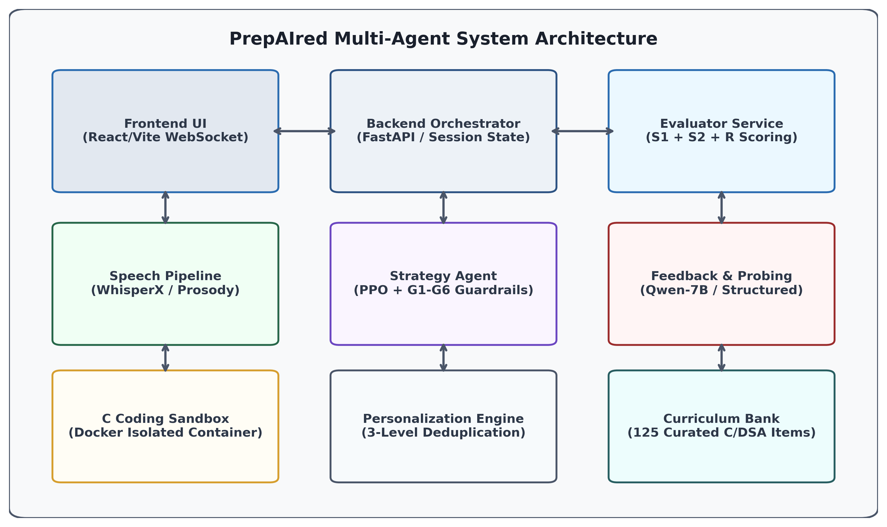

# PrepAIred — A Personalized Adaptive Framework for Multimodal Technical Interview Assessment and Preparation

[](testing_and_evaluation/Master_Results_Table.md)
[](research/CANONICAL_SCIENTIFIC_TRUTH_CURRENT.md)
[](LICENSE)

> **Note on this README's figures (2026-11-13):** the badges and "Key Research Findings" below were previously out of date relative to this project's own canonical evidence record and have been corrected here. The sole current authority for every verified metric is [`research/CANONICAL_SCIENTIFIC_TRUTH_CURRENT.md`](research/CANONICAL_SCIENTIFIC_TRUTH_CURRENT.md) — if a number here and that file ever disagree again in the future, the canonical file is correct.

> **PrepAIred** is an open-source, multimodal, closed-loop adaptive technical interview preparation platform. It combines speech prosody analysis, calibrated neural short-answer grading ($S_1+S_2+R$), containerized Docker C execution, and safety-guardrailed Proximal Policy Optimization (PPO) reinforcement learning for dynamic difficulty adaptation.

---

## 🏛️ System Architecture



```
Candidate (Audio/Code/Text)
   │
   ├──► [1] Audio & Prosody Analysis (Whisper STT, Pacing, Hesitation ht, Confidence ct)
   │
   ├──► [2] Calibrated Neural Evaluator (S1 SBERT + S2 FAISS + R CrossEncoder Entailment)
   │          └─ Anti-Keyword Dampening: S2_eff = (S2 if R > 0.30 else 0.60 * S2)
   │
   ├──► [3] 6D Candidate State Vector: st = [s_avg, ct, ht, tau_t, st, dt] in [0, 1]^6
   │
   ├──► [4] Guardrailed PPO Difficulty Controller (PPO Policy + 6 Safety Guardrails)
   │          └─ Action: Delta d in {-1 (Easier), 0 (Same), +1 (Harder)}
   │
   ├──► [5] 3-Tier Question Selector & Personalization (0.0% Question Repetition)
   │
   ├──► [6] Hardened Docker C Coding Sandbox (128MB RAM, 32 PIDs, 2.0s, --net=none)
   │
   └──► [7] Formative Feedback & Targeted Probing (Local Qwen GGUF / Structured Fallback)
```

---

## 🔬 Key Research Findings (current, verified)

Full detail, uncertainty, and provenance for every figure below: [`research/CANONICAL_SCIENTIFIC_TRUTH_CURRENT.md`](research/CANONICAL_SCIENTIFIC_TRUTH_CURRENT.md) and [`research/claims/CLAIM_REGISTRY.csv`](research/claims/CLAIM_REGISTRY.csv).

1. **Answer-evaluator human correlation:** the composite evaluator ($S_1+S_2+R$) correlates with human reference scores at Spearman $\rho = 0.3812$ (95% CI [0.158, 0.577]; 3 raters, 64 constructed answers, 8 questions) — reported as **exploratory, initial evidence**, not a validated accuracy claim. An earlier, frequently-cited figure of $\rho = 0.6975$ was a 1-rater, 20-sample pilot and is **superseded**; it is not the current result.
2. **RL difficulty controller:** a pre-registered confirmatory test finds the trained PPO policy's contribution to difficulty-tracking accuracy, over a trivial constant action under the same deterministic guardrail layer, is **not statistically distinguishable from zero** — the guardrail layer, not the learned policy, accounts for the system's measurable adaptive behavior. Reported as a genuine equivalence finding, not omitted because it is unfavorable.
3. **Guardrail safety verification:** systematic boundary testing of the deployed guardrail layer found and closed a genuine coverage gap (performance scores in [0.30, 0.40) were previously unguarded against a policy-proposed difficulty escalation).
4. **Feedback LLM role:** direct code-path verification confirms the locally hosted feedback model (Qwen2.5-1.5B-Instruct, CPU, quantized GGUF, via llama.cpp) never computes or adjusts the numeric score — it is confined to narrative feedback and follow-up-question generation.
5. **Automated test suite:** 264/283 executable backend tests passing (93.3%); every one of the 19 remaining failures is individually attributed (18 to an unavailable Docker daemon in the test environment, 1 to a single pre-existing, documented known issue) — zero unexplained failures.

*Scientific boundary, stated plainly: all RL training and evaluation is simulation-based (no real-candidate data); the human-correlation study is small and researcher-constructed; no human-subject usability or learning-outcome evaluation has been conducted. These are open, disclosed limitations, not resolved by the figures above.*


---

## ⚡ Dual Configuration Architecture

```
================================================================================
CONFIG A: RESEARCH SCIENTIFIC EVIDENCE (EXP-3)
================================================================================
- Model: Qwen/Qwen2.5-7B-Instruct (bfloat16) on NVIDIA Tesla T4 GPU (CUDA 12.8)
- Measured Latency: 9.78s per turn (Grounding = 0.2496, Gap Coverage = 72.5%)
- Raw Artifacts: research/results/raw/experiment_3_qwen_raw.json
- Scope: Frozen scientific evidence supporting the manuscript.
================================================================================

================================================================================
CONFIG B: LIVE DEMO & CLASSROOM DEPLOYMENT (CPU-ONLY)
================================================================================
- Model: Qwen/Qwen2.5-1.5B-Instruct-GGUF (Q4_K_M, 1.06 GB)
- Runtime Engine: llama.cpp / llama-cpp-python (CPU-Only, 12 threads)
- Measured Latency: ~1.8s - 2.9s per task (Mean = 2.195s, 18.79 tok/s)
- Process RAM: ~1.36 GB RSS
- Fallback System: Sub-50ms deterministic rubric-grounded recovery
- Scope: High-speed local live demo without dedicated GPUs.
================================================================================
```

---

## 🚀 Quick Start — Reproduction & Local Demo

### 1. Clone & Configure Environment
```bash
# Clone the repository
git clone https://github.com/sparshkumar1/capstoneProject.git
cd capstoneProject

# Create and activate Python virtual environment
python -m venv .venv
.\.venv\Scripts\Activate.ps1    # Windows PowerShell (or source .venv/bin/activate on Linux/macOS)

# Install dependencies
pip install --upgrade pip
pip install -r requirements/base.txt -r requirements/evaluator.txt -r requirements/rl.txt -r requirements/qwen.txt
pip install -e .


# Install frontend dependencies
npm --prefix apps/web install
```

### 2. (Optional) Local Qwen 1.5B LLM Setup
```bash
# Download quantized GGUF model weights (~1.06 GB)
python scripts/download_qwen_model.py

# Verify genuine local CPU inference via llama.cpp
python scripts/verify_qwen_live.py
```

### 3. Run Automated Verification Suites
```bash
# Backend test suite (283 executable tests; 264 pass, 19 fail — all individually
# attributed to an unavailable Docker daemon or one pre-existing known issue,
# see testing_and_evaluation/Master_Results_Table.md)
EVALUATOR_MOCK_MODE=1 python -m pytest tests/ -v

# Frontend component suite (28 passed)
npm --prefix apps/web test -- --run

# Deterministic paper-reproduction harness (figures traced in research/CANONICAL_SCIENTIFIC_TRUTH_CURRENT.md)
python scripts/reproduce_paper.py
```

### 4. Launch Local Demo Services (4-Terminal Setup)
```bash
# Terminal 1: Qwen Microservice (Port 8001)
python -m services.qwen.app

# Terminal 2: Evaluator Microservice (Port 5000)
python services/evaluator/app.py

# Terminal 3: FastAPI Backend Server (Port 8000)
python -m uvicorn apps.backend.main:app --host 0.0.0.0 --port 8000 --reload

# Terminal 4: React Web Client (Port 3000)
npm --prefix apps/web run dev
```
Open your browser at `http://localhost:3000` to start an interactive mock interview.


---

## 🗂️ Repository Structure

| Path | What's there |
|---|---|
| `apps/backend/` | FastAPI backend — session orchestration entry point, admin routes |
| `apps/web/` | React 18 + Vite frontend |
| `agents/` | Orchestrator, audio/speech pipeline, coding executor, question selector, strategy (RL+guardrails) |
| `services/evaluator/` | Flask microservice — the composite answer-scoring pipeline (S1+S2+R) |
| `services/qwen/` | FastAPI microservice — local Qwen2.5-1.5B-Instruct feedback/follow-up generation |
| `services/storage/` | SQLite persistence layer |
| `rl/` | PPO environment, training code, and frozen checkpoints |
| `data/` | Question bank, rubrics, the SQLite database file |
| `tests/` | The project's pytest/Vitest automated test suites |
| `testing_and_evaluation/` | The authoritative, ongoing testing/evaluation documentation and scripts (test strategy, baseline results, category-specific test scripts, final-evaluation-phase reports) |
| `testing_output/` | A self-contained, one-off comprehensive testing report deliverable (PDF/CSV), separate from the above — see `testing_output/README.md` |
| `research/` | Frozen research results, audits, and the canonical scientific-truth document |
| `paper/` | The active IEEE-format paper workspace |
| `final_deliverables/` | Packaged academic deliverables: university report, IEEE paper, presentation |
| `Independent_Project_Audit/` | A standalone, evidence-first independent audit of the whole project |
| `experiments/`, `ablation/` | Legacy experiment runners and ablation-study results |
| `scripts/` | Setup, model-download, and end-to-end verification utility scripts |
| `docs/` | A large, partly-historical documentation set; treat `research/CANONICAL_SCIENTIFIC_TRUTH_CURRENT.md` as authoritative over anything here that disagrees with it |
| `Details/`, `capstonePapers/`, `ADCOM2027_Track2_Final/`, `submission/`, `reference_material_analysis/` | External/historical manuscript material — each has its own `README.md` explaining its contents |

## 📚 Complete Project Documentation Index

- **Master Manual & Defense Guide:** [`docs/PREPAIRED_COMPLETE_BOOKLET.md`](docs/PREPAIRED_COMPLETE_BOOKLET.md) (Complete 31-section compendium)
- **Independent Tester Checklist:** [`docs/FRIEND_REPRODUCTION_CHECKLIST.md`](docs/FRIEND_REPRODUCTION_CHECKLIST.md) (Step-by-step external tester protocol)
- **IEEE Research Manuscript Draft:** [`docs/paper_draft_ieee.md`](docs/paper_draft_ieee.md) (29-section formal manuscript)
- **Results Traceability Matrix:** [`docs/PAPER_RESULTS_TRACEABILITY.md`](docs/PAPER_RESULTS_TRACEABILITY.md) (100% dataflow verification)
- **Claims Verification Matrix:** [`docs/CLAIMS_CHECK.md`](docs/CLAIMS_CHECK.md) (16-claim evidence ledger)
- **System Testing Compendium:** [`docs/SYSTEM_TESTING.md`](docs/SYSTEM_TESTING.md) (Full test inventory)
- **GitHub Release Notes:** [`docs/GITHUB_RELEASE_DESCRIPTION.md`](docs/GITHUB_RELEASE_DESCRIPTION.md) (`paper-v1.0`)
- **Repository Tree Inventory:** [`docs/FINAL_REPOSITORY_TREE.md`](docs/FINAL_REPOSITORY_TREE.md)

---

## 🛡️ Hardened Coding Sandbox Policy

Untrusted candidate C code executes in an isolated Docker container (`Dockerfile.sandbox`):
- **Memory:** $128\text{ MB}$ limit (`--memory=128m --memory-swap=128m`)
- **PIDs:** $32\text{ max}$ (`--pids-limit=32` to stop fork bombs)
- **Timeout:** $2.0\text{ seconds}$ CPU wall time
- **Network:** Completely disabled (`--net=none`)
- **Filesystem:** Read-only root with transient memory tmpfs

---

## 📜 Licenses

- **Platform Code:** MIT License ([LICENSE](LICENSE))
- **Qwen2.5-1.5B-Instruct-GGUF:** Apache-2.0 License
- **Qwen2.5-7B-Instruct:** Apache-2.0 License
- **Sentence-Transformers (MiniLM):** Apache-2.0 License

---

## 📖 Citation

```bibtex
@article{kumar2026prepaired,
  title={A Personalized Adaptive Framework for Multimodal Technical Interview Assessment and Preparation},
  author={Kumar, Sparsh and PrepAIred Research Group},
  journal={IEEE Transactions on Learning Technologies (Under Review)},
  year={2026}
}
```
