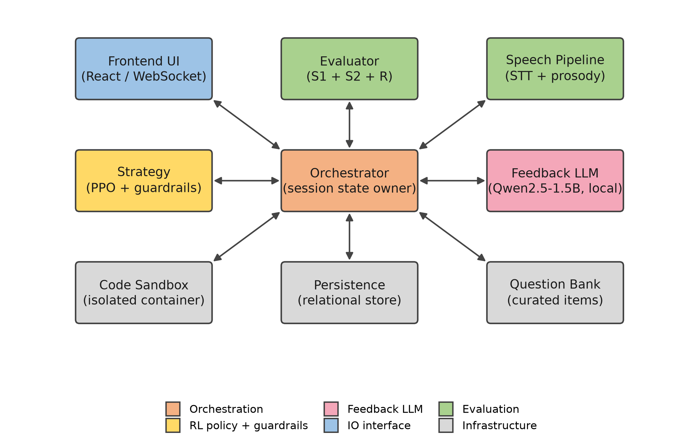

# PrepAIred: A Specialised Agentic Architecture for Adaptive Multimodal Technical Interview Preparation

*Anonymous authors (double-blind submission)*

**Abstract—**Technical-interview preparation tools typically present fixed-difficulty question pools and coarse, unexplained scoring, with no modular separation between evaluation, adaptation, feedback and execution. We present PrepAIred, a deployed system built as a specialised, orchestrator-coordinated agentic architecture, in which a central orchestrator mediates nine specialised components: a rubric-anchored three-component answer evaluator, a Proximal Policy Optimization (PPO) difficulty controller, a deterministic priority-ordered guardrail layer, a feedback-only large language model, an isolated code-execution sandbox, a speech-analysis pipeline, and supporting state, scoring and timing services. We argue that this decomposition is a research asset, not only an engineering convenience: because difficulty adaptation is split into an independently testable learned component and an independently testable deterministic component, we could design a confirmatory experiment attributing the system's measurable adaptive behavior to one specific component rather than to the architecture as an undifferentiated whole. We report four such component-attributed findings, each verified directly against the implementation. First, the evaluator correlates with human judgment at Spearman rho = 0.3812 (95% CI [0.158, 0.577]; 3 raters, 64 answers), a moderate, exploratory result. Second, the feedback-only language-model component never computes or adjusts the numeric score, confirmed by direct code-path tracing. Third, a matched multi-seed comparison and a pre-registered confirmatory test attribute the system's measurable difficulty-tracking behavior to the deterministic guardrail component, not the learned policy, whose marginal contribution is statistically indistinguishable from zero under the same shield. Fourth, boundary testing of the guardrail component found and closed a genuine safety-coverage gap. A formal comparison against a unified single-controller baseline has been designed but, as a disclosed limitation, not yet executed.

**Keywords—**specialised agentic architecture, orchestrator-coordinated systems, adaptive interview preparation, reinforcement learning, large language models, automated answer evaluation, equivalence testing, software guardrails

## I. Introduction

Existing technical-interview preparation tools present a fixed sequence of questions at fixed or self-selected difficulty, score answers through binary or coarse numeric checks where scoring exists at all, and provide no structured explanation of why an answer was scored as it was [9]. This leaves two populations poorly served: candidates above the pool's difficulty, and candidates for whom it offers no scaffolded improvement path. A natural response is to decompose the problem — evaluation, difficulty adaptation, safety, feedback, execution — into separately specified, separately testable components under a central controller, rather than one undifferentiated function. This paper asks a question rarely examined once such a system is deployed: where a learned component is paired with a deterministic safety component inside that decomposition, can the architecture's own separability determine which specific component is responsible for the system's observed behavior?

We present PrepAIred, a deployed adaptive technical-interview system for C-language and data-structures practice, engineered as a specialised, orchestrator-coordinated agentic architecture. A central orchestrator coordinates nine specialised components, each with a distinct responsibility and decision authority: a three-component answer evaluator, a frozen PPO [6] policy proposing difficulty adjustments, a six-rule deterministic guardrail layer that may override it, a language model used only for narrative feedback, a speech-analysis pipeline, an isolated code-execution sandbox, and candidate-state, scoring and timing services. We report this architecture's full evidence record component by component — including an unfavorable result for one learned component — because attributing a system-level finding to one specific component, rather than the architecture in aggregate, is a direct consequence of building it as a decomposed, orchestrator-coordinated architecture rather than one fused controller.

**Contributions.** (1) A deployed specialised, orchestrator-coordinated architecture whose nine components are individually classified by responsibility and decision authority, rather than assumed uniformly autonomous. (2) A demonstration that this decomposition enables component-level attribution: a matched, multi-seed comparison and pre-registered equivalence test isolate the learned policy's marginal contribution from the guardrail's, finding the former statistically indistinguishable from zero. (3) An exploratory, disclosed human-correlation validation of the evaluator (rho = 0.3812, 3 raters, 64 answers), with a component ablation and trivial-baseline comparison. (4) Code-level verification that the feedback-only language model never influences the numeric score, and boundary testing that closed a genuine guardrail safety gap. (5) An explicit architectural-comparison research design — not yet executed — for this architecture against a fair unified single-controller baseline.

**What we do not claim.** We do not claim autonomous, peer-to-peer multi-agent collaboration: a dependency audit (§III-B) found no component invoking another as a communicating peer. We make no claim of real-candidate outcome improvement (RL is simulation-based); we do not claim publication-grade evaluator validation; and we do not claim specialisation has been experimentally shown to outperform a unified controller — that comparison is designed (§III-F) but not run.

## II. Related Work and Research Gap

**Automated and LLM-assisted scoring.** AutoSCORE [3] decomposes essay scoring across specialist agents coordinated by a validating agent, outperforming monolithic LLM scoring; independent studies [1],[2] find LLM-based scoring reliable but prompt- and domain-dependent. PrepAIred's evaluator is structurally similar — three deterministic, fixed-weight components rather than an LLM judge — for the same reliability reason: a generative component supplies only feedback text, never the score, which we verify directly (§IV-C, §V-B).

**Grounded verification.** Argos [5] shows that grounding a reward signal in independently checkable evidence, rather than a learned component's own output, reduces hallucination-driven error in agentic RL — the same principle behind PrepAIred's deterministic scoring path and this paper's component-attribution discipline.

**Multi-agent coordination evaluation.** MultiAgentBench [4] establishes milestone-based evaluation of multi-agent coordination quality. We cite its evaluation-methodology principle — attributing an outcome to a specific internal mechanism, not the system as a whole — applied here at the orchestrator/policy/guardrail boundary; PrepAIred itself is orchestrator-coordinated with no verified inter-component arbitration, not a peer-to-peer multi-agent system.

**Curriculum and difficulty adaptation.** Automated curriculum learning [12],[13] and intelligent-tutoring knowledge tracing [10],[11] motivate using a learned policy to sequence difficulty. PrepAIred's RL controller follows this tradition; our contribution is a decomposition-enabled test of whether that component, deployed behind a safety component, performs the identified adaptive work.

**Multimodal interview analysis.** Prior work analyzes interviews from video and multimodal features [14],[15]. PrepAIred captures audio-derived confidence and hesitation via a dedicated speech component but, by design, no video or facial analysis — a disclosed scope limitation.

**Gap addressed.** No prior work reports a specialised, orchestrator-coordinated architecture whose decomposition is itself used to run a confirmatory test attributing adaptive behavior to one internal component, paired with an equally disclosed evaluator validation and an explicit, not-yet-executed design for comparing against a unified baseline. This paper reports all three.

## III. Specialised Agentic Architecture

### A. Central Orchestration

PrepAIred is organized as a hub-and-spoke, orchestrator-coordinated architecture (Fig. 1).

**Fig. 1.** PrepAIred system architecture. Arrows indicate verified data/control flow between the nine major components; there is no inter-agent arbitration layer.

A central orchestrator — one instance per interview session — owns all session state and mediates every other component: it dispatches each turn event to the relevant component, aggregates outputs into candidate state, and decides the next action. A repository-wide dependency audit, searching every component's source for an import of or call into any sibling, found zero cross-component edges; the one exception is the feedback component issuing its own request to the language-model service, independent of the orchestrator. Coordination here is centralised, not peer-to-peer.

### B. Specialised Components and Their Classification

Table I classifies each component by decision authority: (A) a genuinely learned or generative decision, (B) specialised logic with bounded, rule-governed authority, (C) a deterministic service with no authority beyond fixed rules, (D) an ordinary utility. No component is classified as a fully autonomous agent negotiating with peers; Category A is reserved for output produced by a trained or generative model, the strongest decision-making property this architecture exhibits.

**Table I. Component classification by decision authority**

| Component | Category | Decision authority |
|---|---|---|
| Orchestrator | B | Coordinates turns; conditional branching, not learned decisions |
| RL difficulty policy (PPO) | A | Trained forward pass proposes a difficulty action |
| Guardrail layer | C | Six fixed priority-ordered rules may override the proposal |
| Answer evaluator | C | Fixed three-term weighted scoring formula |
| Feedback component (+LLM) | B | Template logic; optional generative narrative text only |
| Code-execution sandbox | C | Fixed compile/execute/compare rules |
| Speech-analysis pipeline | C | Fixed linear signal-processing chain |
| State/scoring/timing services | D | Fixed arithmetic and persistence, no decision logic |

### C. Why Decomposition Matters: Component-Level Attribution

The architectural choice most load-bearing for this paper is that difficulty adaptation is split into two separately callable components — the PPO policy (Category A) and the guardrail layer (Category C) — connected only through the orchestrator, not fused into one function. Because each is callable independently with the same inputs, we could hold the guardrail fixed while substituting the policy with a trivial constant action (§V-C), isolating which component's output explains the observed behavior; a fused implementation would not permit this without rewriting itself for the experiment. This is the architectural advantage we demonstrate with evidence: not that specialisation improves the outcome, but that it makes the outcome's cause identifiable.

The remaining components follow the same rationale: the evaluator, speech pipeline and sandbox are each independently testable against their own ground truth, which is how the per-component results in §V were obtained, and the feedback component's narrative-only scope is verified, by code inspection, never to alter the numeric score (§V-B).

## IV. Methodology and Formulation

### A. Composite Answer Evaluation

Given a candidate answer split into sentences and a rubric, the evaluator computes three scores. The semantic score S1 averages, over each rubric target c, the best cosine similarity between a Sentence-BERT [7] embedding of c and any candidate sentence. The concept-coverage score S2 is the fraction of concepts whose best-matching similarity exceeds θ = 0.30, via a FAISS index [8]. The reasoning score R is a fine-tuned cross-encoder's rescaled relevance judgment. S2 is dampened when R is low: S2,eff = S2 if R > 0.30, else 0.6·S2. The final score is score = 0.15·S1 + 0.35·S2,eff + 0.50·R (plus bonus/penalty), clamped to [0,1], capped if a mandatory concept is absent — safety-hardened rather than accuracy-optimal, which directly informs §V-A.

### B. RL Difficulty Policy and Guardrail Component

The environment state is s = [perf, avg_perf, conf, hes, progress, diff/5] ∈ [0,1]^6; the action space is discrete, a ∈ {Easier, Same, Harder}. The policy trains with a hybrid reward r = 0.6·r_decision + 0.3·r_outcome + 0.1·r_shaping + r_stability + r_critical, where r_decision = ±1 against a hand-coded rule oracle. The guardrail component, G(s, a_proposed) → a_final, applies six priority-ordered rules before the action executes, in both training and inference. Because the reward is computed on the post-guardrail action, the policy is trained to agree with whichever action the guardrail ultimately selects — directly relevant to §V-C. As a disclosed implementation detail outside this paper's experimental scope: the live orchestrator invokes its own copy of the guardrail rules rather than the canonical training/evaluation module, and the two currently diverge on one rule boundary.

### C. Feedback Component (Qwen)

A locally hosted Qwen2.5-1.5B-Instruct model (CPU, quantized) generates narrative feedback, hints and follow-up questions, invoked only after the evaluator finalizes the score. Every code path that could populate a numeric-score field in its response was traced and found to read that value from the evaluator's own pre-computed result, never to compute it independently; text matching a self-asserted numeric-score pattern is rejected before being shown to the candidate.

## V. Experimental Evaluation and Results

### A. Evaluator Human-Correlation Study

Three raters independently scored 64 constructed candidate answers spanning 8 questions, producing a gold score via mean or adjudicated aggregation. The composite evaluator correlates with the human gold label at rho = 0.3812 (95% CI [0.158, 0.577]; Fig. 2). Table II reports each component in isolation.

**Fig. 2.** Composite evaluator score vs. human reference score, 64 constructed answers. The dashed line marks equality.

**Table II. Evaluator correlation with human reference score, by configuration**

| Configuration | Spearman rho | 95% CI |
|---|---|---|
| Full composite | 0.381 | [0.158, 0.577] |
| Cross-encoder R only | 0.483 | [0.246, 0.698] |
| S1 + R | 0.488 | [0.254, 0.712] |
| S1 (semantic) only | 0.207 | [-0.023, 0.501] |
| Word-count baseline | 0.490 | [0.219, 0.708] |

The full composite correlates below the cross-encoder alone, consistent with its safety-hardened design; a trivial word-count baseline matches the cross-encoder's correlation — an unflattering result reported rather than omitted. We treat this as exploratory evidence for the evaluator component specifically, not a validated claim for the architecture as a whole.

### B. Feedback-Component Role Verification

We traced every code path in the feedback component and language-model service that computes or could overwrite the numeric score, confirming neither is ever on that path, and confirmed a run-time guard rejects generated text asserting its own score. This supports Table I's classification: the feedback component is Category B (bounded, narrative-only), never Category A for scoring.

### C. Component-Attributed Difficulty-Control Comparison

Five trained policy seeds were evaluated under a matched design: five personas, five evaluation seeds, four conditions (fixed, heuristic, PPO raw, PPO+guardrails), identical draws across conditions. Table III reports tracking MAE; lower is better.

**Table III. Difficulty-tracking error by condition (5 personas x 5 seeds)**

| Condition | Tracking MAE |
|---|---|
| Fixed difficulty | 1.200 |
| Rule-based heuristic | 0.473 |
| PPO (raw policy) | 0.804 |
| PPO + guardrails | 0.677 |

The rule-based heuristic outperforms every PPO variant. A pre-registered confirmatory test compared PPO+guardrails against a constant-"Same" action under the identical guardrail, on a held-out 40-persona grid: the 95% CI for the difference crosses zero (Fig. 3) — the policy's contribution beyond the guardrail is not statistically distinguishable from zero, and is measurably more volatile under the same shield. Because the two components are independently callable (§III-C), this substitution test required modifying neither's implementation; we attribute the system's measured adaptive behavior to the guardrail on this evidence.

**Fig. 3.** Tracking-MAE difference (PPO+guardrails minus constant-action+guardrails) across the primary estimator and six robustness checks. The shaded band is the pre-registered equivalence margin.

### D. Guardrail Component Boundary Verification

Boundary testing found performance scores in [0.30, 0.40) unguarded against a policy-proposed escalation; a single-condition threshold widening closed the gap (13/13 boundary cases passing, zero regressions across 283 tests). This defect and fix are specific to the guardrail component in isolation, found by testing its own rule boundaries directly rather than the system end-to-end — a benefit of independent callability.

### E. System and Component-Level Testing Summary

A broader testing programme exercised the orchestrator's dispatch logic, API contract, database integrity, adversarial input handling, and sandbox configuration; 264/283 tests pass (93.3%), with all 19 remaining failures traced to one unavailable external dependency or one pre-existing, unrelated issue. A later pass re-ran the full suite with zero regressions, confirmed via hash recomputation that the deployed and §V-C-evaluated PPO checkpoints are distinct artifacts, and passed Gymnasium's standard environment check. Table IV summarizes this evidence.

**Table IV. System and post-deployment verification evidence, by component**

| Component / check | Method | Result |
|---|---|---|
| API contract (orchestrator) | Direct test-client calls | 7/7 pass |
| Adversarial input (evaluator) | 10 edge-case texts | 10/10, no crash |
| DB integrity (state service) | Live-store inspection | 0/52, 0/26 orphaned |
| Sandbox configuration | Code inspection | All flags present |
| Frontend | Automated UI suite | 28/28 pass |
| Full regression suite, pre/post-fix | Re-run before/after 3 fixes | 264/19/15, zero regressions |
| Gymnasium `check_env()` | Standard interface check | Passed, no warnings |
| PPO checkpoint identity | Hash recomputation | Deployed vs. evaluated confirmed distinct |

### F. Architectural Comparison: Status and Design

A formal comparison between this architecture and a unified single-controller baseline — same underlying models and services, coordinated by one controller instead of several specialised classes — has been fully designed (fairness checklist, 17-category benchmark, primary/secondary metrics, statistical plan) but **not** executed: no baseline is implemented and no comparative result exists at the time of writing. We report this as a limitation, not an experimentally shown advantage.

## VI. Discussion

The evidence in §V supports three distinct, separately-held claims. First, decomposing difficulty adaptation into a learned-policy and a deterministic-guardrail component let a pre-registered test identify which one is responsible for the system's adaptive behavior — the guardrail, not the policy: a demonstrated benefit of specialisation (attributability), not superior performance from either mechanism. Second, scoping the language-model component to narrative generation only, and verifying that scope by code inspection rather than design intent, is a second benefit: a component's authority can be bounded and checked, harder to do in a fused implementation with no seam to inspect. Third, central orchestration integrates these components across turns, modalities and failure conditions, which §V-D/§V-E's component-level testing confirms works at the measured scope — real integration, not a trivial pass-through.

This evidence does not support a claim that the architecture outperforms a unified controller end-to-end (§III-F, not run), nor that PrepAIred is a multi-agent system of communicating peers (§III-A found none). The defensible contribution is narrower but substantive: decomposition under central orchestration made a component-level attribution finding possible to obtain at all, and made a safety-component defect identifiable and fixable in isolation.

## VII. Conclusion and Future Work

We presented PrepAIred as a specialised, orchestrator-coordinated agentic architecture and reported its evidence record component by component, with uniform rigor regardless of outcome: exploratory, moderate evaluator correlation, a feedback-only language model verified rather than merely claimed, a decomposition that enabled a pre-registered test attributing adaptive behavior to the deterministic guardrail, and guardrail boundary testing that closed a genuine safety gap. Future work includes executing the designed single-controller comparison (§III-F) rather than leaving it a design artifact; a larger human-correlation study; bounding the cross-encoder's fine-tuning provenance; and a reward trained directly against the tracking metric.

## References

[1] A. Karjus et al., "Machine-Assisted Grading of Nationwide School-Leaving Essay Exams with LLMs and Statistical NLP," arXiv:2601.16314, 2026.
[2] P. C. Mendonça, F. Quintal, and F. Mendonça, "Evaluating LLMs for Automated Scoring in Formative Assessments," Applied Sciences, vol. 15, no. 5, Art. no. 2787, 2025, doi: 10.3390/app15052787.
[3] Y. Wang et al., "AutoSCORE: Enhancing Automated Scoring with Multi-Agent Large Language Models via Structured Component Recognition," arXiv:2509.21910, 2025.
[4] K. Zhu, H. Du et al., "MultiAgentBench: Evaluating the Collaboration and Competition of LLM Agents," in Proc. ACL, vol. 1, pp. 8580-8622, 2025.
[5] Microsoft Research, "Argos: Multimodal Reinforcement Learning with Agentic Verifier for AI Agents," arXiv:2512.03438, 2025.
[6] J. Schulman, F. Wolski, P. Dhariwal, A. Radford, and O. Klimov, "Proximal Policy Optimization Algorithms," arXiv:1707.06347, 2017.
[7] N. Reimers and I. Gurevych, "Sentence-BERT: Sentence Embeddings using Siamese BERT-Networks," in Proc. EMNLP, 2019.
[8] J. Johnson, M. Douze, and H. Jégou, "Billion-Scale Similarity Search with GPUs," IEEE Trans. Big Data, vol. 7, no. 3, pp. 535-547, 2019.
[9] D. J. Weiss, "Improving Measurement Quality and Efficiency with Adaptive Testing," Applied Psychological Measurement, vol. 6, no. 4, pp. 473-492, 1982.
[10] J. R. Anderson, A. T. Corbett, K. R. Koedinger, and R. Pelletier, "Cognitive Tutors: Lessons Learned," The Journal of the Learning Sciences, vol. 4, no. 2, pp. 167-207, 1995.
[11] A. T. Corbett and J. R. Anderson, "Knowledge Tracing: Modeling the Acquisition of Procedural Knowledge," User Modeling and User-Adapted Interaction, vol. 4, no. 4, pp. 253-278, 1994.
[12] A. Graves, M. G. Bellemare, J. Menick, R. Munos, and K. Kavukcuoglu, "Automated Curriculum Learning for Neural Networks," in Proc. ICML, 2017.
[13] R. Portelas, C. Colas, L. Weng, K. Hofmann, and P. Y. Oudeyer, "Automatic Curriculum Learning for Deep RL: A Short Survey," in Proc. IJCAI, 2020.
[14] I. Naim, M. I. Tanveer, D. Gildea, and M. E. Hoque, "Automated Prediction and Analysis of Job Interview Performance: The Role of What You Say and How You Say It," in Proc. 11th IEEE Int. Conf. Workshops Automatic Face and Gesture Recognition (FG), 2015, doi: 10.1109/FG.2015.7163127.
[15] L. Chen, G. Feng, C. W. Leong, B. Lehman, and M. Martin-Raugh, "Automated Scoring of Interview Videos Using Doc2Vec Multimodal Feature Extraction Paradigm," in Proc. 18th ACM Int. Conf. Multimodal Interaction (ICMI '16), 2016, doi: 10.1145/2993148.2993203.
