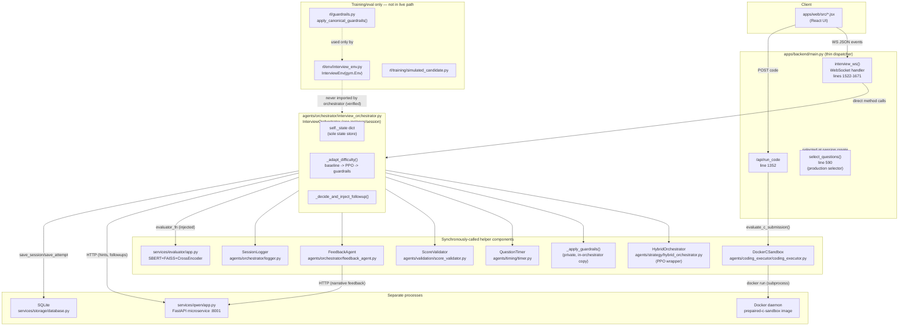

# 17. Comprehensive Architecture Audit — Is PrepAIred Genuinely Multi-Agent?

**Date:** 2026-11-14. **Scope:** static source-code inspection only, per explicit instruction — no application-code
modification, no refactoring, no redesign, no retraining, no dependency changes, no document rewriting. Every
finding below is backed by a direct file/line citation to code read in this session. Where a claim could not be
confirmed by reading code (e.g. live request/response timing, actual Docker daemon behavior under load), it is
explicitly labeled as **not runtime-verified** rather than asserted as observed fact.

---

## 1. Executive Summary

PrepAIred is **not a genuine multi-agent system** in the sense of autonomous, communicating agents that negotiate
or coordinate with each other. It is a **single, large, centrally-orchestrated session controller**
(`InterviewOrchestrator`, `agents/orchestrator/interview_orchestrator.py`, 2300 lines) that synchronously calls a
set of specialized but non-autonomous helper components — a learned RL policy wrapper, a deterministic Docker
sandbox, a deterministic semantic-similarity evaluator, a template-and-optionally-LLM-backed feedback generator,
deterministic timing/scoring utilities, and a separate stateless LLM microservice (Qwen) reached over HTTP.

Every one of these helper components is invoked **only by the orchestrator**; direct grep evidence across
`agents/` and `services/` (§4.1) shows **zero** cross-imports between sibling agent modules — no agent ever calls
another agent directly, with one narrow, documented exception (`FeedbackAgent` calling the Qwen microservice
directly, §4.4). This is a **hub-and-spoke pipeline**, not a mesh of communicating agents.

The system does contain genuinely non-trivial, specialized decision logic — a trained PPO policy (§3.2), a layered
deterministic guardrail system (§3.3, with an important caveat, §7.2), a follow-up-injection policy keyed off
evaluator evidence (§5.D), and an LLM-backed narrative generator with deterministic fallback (§5.E). These
components are legitimately more than "plain utility functions," but none of them is autonomous: none decides
*when* to act, none maintains its own persistent goal state across turns, and none communicates with a peer
component without the orchestrator initiating and mediating the call.

**Classification (§8): Orchestrated modular pipeline with agent-like components.** This is not a pejorative
finding — the orchestration itself is a substantial, well-evidenced piece of engineering (§9) — but it is not
"genuine multi-agent architecture," and several existing documents describe it in language that implies more
agent autonomy and inter-agent collaboration than the code supports (§7).

Static inspection also surfaced one concrete, previously undocumented integration gap, not an opinion: the REST
`/api/run_code` endpoint's test-case lookup (`apps/backend/main.py:1360`) reads a `sess._current_question`
attribute that `InterviewOrchestrator` never defines (§5.B, §12.1) — so test cases are not retrieved through that
path, and a syntactically-compiling submission can be marked `passed` through that endpoint with zero exercised
test cases. This is reported as a static-inspection finding only; it was not reproduced by running the live
stack, and no code was changed to confirm or fix it, per the preservation instruction.

---

## 2. Actual Architecture Overview

Nothing in this diagram is invented from documentation — every edge is backed by a direct read of the file it
names (full citations in §5–§7).

---

## 3. Inventory of All Identified "Agent" Components

For each component: location, responsibility, inputs/outputs, decision logic, state, dependencies, and whether it
is in the live runtime path. ("Live path" = reachable from a real WebSocket/REST request through
`InterviewOrchestrator`, confirmed by import/call-graph inspection, not by running the server.)

### 3.1 `InterviewOrchestrator` — `agents/orchestrator/interview_orchestrator.py`

- **Responsibility:** sole owner of per-session state (`self._state`, built at `__init__`, lines 206–261); drives
  the entire turn lifecycle (`start`, `handle_voice_answer`, `handle_code_submission`, `handle_retry`,
  `handle_next_question`, `skip_question`, `end` — lines 284–1083).
- **Inputs:** WebSocket event payloads forwarded verbatim by `apps/backend/main.py`'s `interview_ws` (lines
  1522–1671).
- **Outputs:** structured dicts (`feedback`, `difficulty_update`, `next_action`) sent back over the WebSocket.
- **Decision-making:** conditional branching on interview phase (baseline vs. RL, lines 1587–1639 vs. 1642–1716),
  on evaluator/Docker/Qwen availability (fail-closed paths, lines 347–348, 542–587), on follow-up eligibility
  (lines 1733–1751), on best-attempt selection across retries (lines 914–934).
- **State:** `self._state` (one dict per session instance), plus bookkeeping sets/dicts
  (`_active_question_attempts`, `_rl_adapted_turns`, `_in_retry_turn`).
- **Invokes:** `HybridOrchestrator`, `QuestionTimer`, `ScoreValidator`, `SessionLogger`, `FeedbackAgent` (all
  direct method calls, lines 148–151 instantiate them); `evaluator_fn` (injected callable, resolves to
  `services/evaluator/app.py` via `apps/backend/main.py:113`); Qwen microservice over HTTP (lines 1496–1526,
  1787–1814); `services.storage.database` functions (multiple call sites, e.g. lines 373, 457, 709, 1123, 2082).
- **Agent-to-agent communication:** none of its helpers call each other; the orchestrator is the only caller of
  every one of them (verified, §4.1).
- **Classification: B — Agent-like component.** It has one clearly defined responsibility, performs substantial
  conditional decision-making, and is the central integration point of the whole system — but it is a
  conventional (if large and carefully written) procedural controller, not an autonomous entity that decides
  *when* to act; it only ever reacts to an incoming event.

### 3.2 `HybridOrchestrator` (RL "Strategy Agent") — `agents/strategy/hybrid_orchestrator.py`

- **Responsibility:** wraps a frozen PPO checkpoint (`rl/checkpoints/seed_123/ppo_final.zip` +
  `vecnormalize.pkl`) to propose a difficulty action.
- **Inputs:** `score`, `current_difficulty`, `session` dict (`suggest()`, lines 184–248).
- **Outputs:** `(new_difficulty, reason, action_name)` tuple.
- **Decision-making:** real model inference (`self.model.predict(norm_obs, deterministic=True)`, line 219) when
  a strictly-validated checkpoint is loaded (action space must be exactly `Discrete(3)`, observation space must
  be exactly `Box(6,)` — lines 278–292); otherwise a 3-line deterministic heuristic (`_heuristic_action`, lines
  251–257).
- **State:** none across calls beyond the loaded model weights themselves (stateless inference per call); the
  6-D observation is rebuilt from the orchestrator's `session` dict every turn (`build_rl_observation`, lines
  55–158).
- **Classification: A/B borderline — learned decision component, but single-purpose and stateless.** It genuinely
  makes a non-trivial, non-hand-coded decision (the PPO forward pass) that is distinguishable from a lookup table
  — this is the single most "agentic" piece of decision logic in the system. It does not, however, maintain
  memory, communicate with other components, or operate outside of being called synchronously once per turn.

### 3.3 Guardrails — two implementations that have diverged

- **Canonical module:** `rl/guardrails.py::apply_canonical_guardrails()` (lines 47–121) — used by
  `rl/env/interview_env.py:39,235` (training/eval), `research/scripts/run_paper3_study.py:52,383`,
  `research/confirmatory/X3-A/*`, and `tests/unit/test_paper3_blockers.py`.
- **Live-path implementation:** `InterviewOrchestrator._apply_guardrails()` (lines 1529–1573) — a **separate,
  hand-duplicated** copy of the same six rules, called from `_adapt_difficulty` at line 1685.
- **Verified by grep (`apply_canonical_guardrails` across the repo, §4.1):** `agents/orchestrator/
  interview_orchestrator.py` **never imports `rl.guardrails`** — confirmed by a direct grep for
  `guardrail|import.*rl\.|from rl` inside that file (only the private method and its call sites match; no
  import statement).
- **Consequence — a verified divergence, not a hypothesis:** `rl/guardrails.py`'s G3/G5 rule was deliberately
  widened on 2026-11-12 from `0.40 < perf < 0.65` to `0.30 <= perf < 0.65` (documented in the module's own
  docstring, lines 18–30, as a fix for a real coverage gap found during testing). The orchestrator's private
  `_apply_guardrails` (line 1561) still reads `if 0.40 < perf < 0.65 and avg_perf < 0.60 and consec < 2:` — the
  **old, unfixed boundary**. The orchestrator's copy also has no equivalent of `rl/guardrails.py`'s
  "Infrastructure Failure Protection" rule (lines 81–83 of that file). **The guardrail fix that research
  documents describe as closing a real safety gap was applied to the module used for RL training/evaluation and
  frozen-result reproduction, but not to the module that actually runs during a live interview session.**
- **Classification: C — deterministic service**, for both copies; the finding above is a documentation/
  implementation-fidelity issue (tracked in §7), not a classification issue.

### 3.4 `FeedbackAgent` — `agents/orchestrator/feedback_agent.py`

- **Responsibility:** builds the 15+-field structured feedback payload for verbal answers (`generate()`, lines
  85–238) and code submissions (`generate_code_feedback()`, lines 240–360).
- **Inputs:** transcript/code, question dict, evaluator result, audio result, session history.
- **Decision-making:** topic-keyed misconception pattern matching (`_MISCONCEPTIONS` dict, lines 33–60, matched
  in `_detect_incorrect`, lines 400–436 — note: not actually called from `generate()`'s main path, see §12.2);
  trend detection against score history (`_trend`, lines 495–505); a deterministic justification template
  (`_justification`, lines 507–523) used whenever the Qwen microservice is unreachable or its output fails
  validation.
- **Agent-to-agent communication:** `_query_qwen_feedback` (lines 525–573) makes its **own** direct HTTP call to
  `http://localhost:8001`, independent of the orchestrator — the one place in the codebase where a non-
  orchestrator component talks to another service directly.
- **State:** module-level singleton `FEEDBACK_AGENT = FeedbackAgent()` (line 577) — shared across all sessions,
  but holds no per-session state itself (`self._qwen_ok` is a liveness flag, not candidate state); all session
  context is passed in as call arguments.
- **Classification: B — Agent-like component.** Non-trivial, template-plus-optional-LLM decision logic;
  genuinely specialized; but deterministic at its core and reactive only.

### 3.5 `DockerCSandbox` / `evaluate_c_submission` — `agents/coding_executor/coding_executor.py`

- **Responsibility:** compile and execute untrusted C code in an isolated container (`compile_and_execute`,
  lines 130–460).
- **Decision-making:** none beyond fixed rules — exit-code classification (lines 359–378), mandatory-test score
  cap (lines 430–434), pass/fail determination (line 438). No branching depends on anything other than the
  process's own exit code and declared test-case metadata.
- **State:** none across calls; a fresh container per compile/run (`_new_container_name`, lines 96–98).
- **Classification: C — deterministic service.** Despite being one of the most carefully engineered and
  security-hardened parts of the system (§9.5), it makes no decisions beyond fixed comparison rules.

### 3.6 Question Selection — two components, one of them not in the live path

- **`agents/question_selector/question_selector.py`:** its own module docstring (lines 1–11) states:
  *"CLASSIFICATION: BASELINE / RESEARCH... Authoritative Production Selector:
  `apps.backend.main.select_questions`."* It is a simple global-dict-based random selector with a hard topic
  cap (lines 190–337).
  - **Classification: E — Documentation/research-only component.** It is real, working code, but it is not the
    production path, by its own documented admission — not a "live" agent despite living under `agents/`.
- **`apps/backend/main.py::select_questions()` (lines 590–727):** the actual production selector — a
  deterministic scored-heuristic function (difficulty-distance penalty + topic-diversity penalty +
  personalization bonus/penalty for weaknesses/strengths + 3-level deduplication: ID, normalized text, Jaccard
  token overlap ≥ 0.75, lines 620–675). It is a plain function, not a class, with no persistent state of its
  own beyond the module-level `QUESTION_BANK`.
  - **Classification: C — deterministic service / pipeline.** It is genuinely sophisticated scoring logic, but
    every term in its scoring function is a fixed, hand-written rule; it is not an "agent" by any class/autonomy
    criterion, and it is not a class instance at all.

### 3.7 Audio pipeline — `agents/audio/*`

- `agents/audio/main.py`'s own docstring calls it "PrepAIred Audio Agent," but `run_pipeline()` (lines 34–77) is
  a strictly linear sequence — record → (parallel: prosody extraction, transcription) → linguistic analysis →
  confidence scoring → hesitation scoring → RL state-vector construction → format — with a `ThreadPoolExecutor`
  used only for concurrency, not for branching or decision-making.
- **Classification: C — deterministic service/pipeline.** No decision point in this file depends on anything but
  fixed function composition over the previous stage's output.

### 3.8 Qwen microservice — `services/qwen/app.py`

- **Responsibility:** separate FastAPI process (`app = FastAPI(...)`, line 314) exposing `/api/qwen/followup`,
  `/api/qwen/feedback`, `/api/qwen/hint`, `/api/qwen/report` (lines 759–855), backed by a locally hosted
  Qwen2.5-1.5B-Instruct GGUF model (per `CLAUDE.md` / `Component_Inspection_Map.md`; not independently re-verified
  by loading the model in this session).
- **Decision-making:** genuinely the most "generative" component — produces free-text follow-up
  questions/feedback from an LLM — but every response path has a deterministic structured fallback
  (`_synthesize_structured_followup`, line 521; `_synthesize_structured_feedback`, line 622) and an output
  validator (`_validate_feedback_output`, line 583) that rejects malformed LLM output before it reaches the
  caller. `interview_orchestrator.py:1807-1814` falls back to calling `_synthesize_structured_followup` locally
  (in-process) when the microservice itself is unreachable.
- **State:** none across calls — each request carries full context (question, candidate answer, history) in its
  payload; the service does not remember prior turns on its own.
- **Classification: B — Agent-like component**, and the component closest to "genuine agent" if judged on
  generative capability alone — but it is a stateless request/response service with no autonomy over when it
  runs, and its outputs are gated by deterministic validation, not trusted outright.

### 3.9 Utilities — `ScoreValidator`, `QuestionTimer`, `SessionLogger`, `services/storage/database.py`

- `agents/validation/score_validator.py` (dataclass, lines 54–60+): fixed-weight score aggregation and
  mandatory-concept capping.
- `agents/timing/timer.py` (lines 22–60+): fixed-formula response-time modifier (`delta_fast`/`delta_overrun`
  constants).
- `agents/orchestrator/logger.py`: turn/session persistence to disk.
- `services/storage/database.py`: 18 plain functions (no class) over SQLite (`get_connection` through
  `get_candidate_history`, lines 29–722).
- **Classification: D — ordinary utility/helper**, all four. None performs any decision beyond fixed arithmetic
  or CRUD.

### 3.10 RL training/evaluation infrastructure — `rl/env/interview_env.py`, `rl/training/simulated_candidate.py`

- `InterviewEnv(gym.Env)` (`rl/env/interview_env.py:50`) and `rl/training/simulated_candidate.py` exist purely
  for PPO training and offline evaluation (confirmed: `interview_orchestrator.py` contains no import of
  `rl.env` or `rl.training` anywhere — grepped, no matches).
- **Classification: E — not part of the live runtime workflow.** They are real, substantial, and relevant to the
  system's research claims (Paper 3, guardrail verification), but they do not execute during an actual candidate
  interview session.

### 3.11 Classification Matrix

| Component | File | Class | Autonomous? | Live path? |
|---|---|---|---|---|
| InterviewOrchestrator | `agents/orchestrator/interview_orchestrator.py` | **B** | No (reactive) | Yes |
| HybridOrchestrator (PPO) | `agents/strategy/hybrid_orchestrator.py` | **A/B** | No (stateless inference) | Yes |
| Guardrails (live copy) | `interview_orchestrator.py:1529-1573` | **C** | No | Yes |
| Guardrails (canonical) | `rl/guardrails.py` | **C** | No | **No** (training/eval only) |
| FeedbackAgent | `agents/orchestrator/feedback_agent.py` | **B** | No | Yes |
| DockerCSandbox | `agents/coding_executor/coding_executor.py` | **C** | No | Yes |
| Qwen microservice | `services/qwen/app.py` | **B** | No | Yes |
| Evaluator | `services/evaluator/app.py` | **C** | No | Yes |
| ScoreValidator | `agents/validation/score_validator.py` | **D** | No | Yes |
| QuestionTimer | `agents/timing/timer.py` | **D** | No | Yes |
| SessionLogger | `agents/orchestrator/logger.py` | **D** | No | Yes |
| Storage (SQLite) | `services/storage/database.py` | **D** | No | Yes |
| select_questions (production) | `apps/backend/main.py:590` | **C** | No | Yes |
| question_selector.py | `agents/question_selector/question_selector.py` | **E** | No | **No** (self-documented baseline) |
| Audio pipeline | `agents/audio/*` | **C** | No | Yes |
| InterviewEnv / simulated_candidate | `rl/env/interview_env.py`, `rl/training/simulated_candidate.py` | **E** | — | **No** (training/eval only) |

No component in this repository meets criterion A ("genuine specialised agent") in full — the closest is the
PPO policy wrapper, which is genuinely decision-making but entirely stateless and non-communicating.

---

## 4. Agent-to-Agent Interaction Analysis

### 4.1 Direct evidence of hub-and-spoke structure

Grep for cross-module imports between sibling agent/service packages (query:
`^from agents\.|^import agents\.|^from services\.|^import services\.` inside `agents/`) returned **zero
matches**. A second grep for relative imports (`^from \.|^from \.\.`) inside `agents/` returned only five
matches, every one of them a package re-exporting its *own* sibling file (`agents/validation/__init__.py`
importing `.score_validator`; `agents/coding_executor/coding_executor.py` importing its own `.sandbox_policy`;
`agents/strategy/__init__.py` importing `.hybrid_orchestrator`; `agents/coding_executor/__init__.py` importing
`.coding_executor`; `agents/timing/__init__.py` importing `.timer`) — none of these cross a module boundary
between two *different* agents.

**Conclusion: no agent in this codebase imports or directly calls another agent.** Every cross-component
interaction is either (a) the orchestrator calling a helper, or (b) a component calling the separate Qwen
*service* over HTTP (not a peer agent import).

### 4.2 Cataloged interactions

| # | Sender | Receiver | Information transferred | Source location | How receiver uses it | Changes subsequent behavior? |
|---|---|---|---|---|---|---|
| 1 | Orchestrator | HybridOrchestrator | score, current_difficulty, full session dict | `interview_orchestrator.py:1654` → `hybrid_orchestrator.py:184` | Builds 6-D obs, runs PPO or heuristic | Yes — determines `new_diff`/`action_name` |
| 2 | Orchestrator | `_apply_guardrails` (self) | action_idx, perf, avg_perf, conf, hes, diff_norm | `interview_orchestrator.py:1685` | May override the PPO/heuristic action | Yes — can flip Easier/Same/Harder |
| 3 | Orchestrator | QuestionTimer | raw_score, time_ratio | `interview_orchestrator.py:408,660` | Computes timing_modifier | Yes — modifies final_score |
| 4 | Orchestrator | ScoreValidator | raw score + evidence dict | `interview_orchestrator.py:1319,1414` | Applies mandatory-cap/penalty rules | Yes — can lower final_score |
| 5 | Orchestrator | FeedbackAgent | transcript/code, eval_result, audio, history | `interview_orchestrator.py:1468,1369` | Builds structured feedback (possibly via Qwen) | Yes — feedback payload sent to client |
| 6 | Orchestrator | evaluator_fn (services/evaluator) | transcript, question/rubric | `interview_orchestrator.py:1311` (via injected `_evaluator_fn`) | Computes S1/S2/R composite score | Yes — becomes `raw_score` |
| 7 | Orchestrator | Qwen (`/followup`) | question, answer, evaluation evidence, history | `interview_orchestrator.py:1793` | Generates a targeted follow-up question or falls back locally | Yes — may insert a new question into the queue |
| 8 | Orchestrator | Qwen (`/hint`) | question text, topic, difficulty | `interview_orchestrator.py:1508` | Generates a hint or returns `llm_unavailable` | Yes — hint text sent to client |
| 9 | FeedbackAgent | Qwen (`/feedback`) | transcript, eval_result, candidate_state, history | `feedback_agent.py:563` | Generates narrative feedback or triggers deterministic fallback | Yes — narrative text in feedback payload |
| 10 | Backend REST | DockerCSandbox | code, test_cases (see §5.B gap) | `apps/backend/main.py:1364` | Compiles/executes, returns pass/fail | Yes — result shown to candidate before WS round-trip |
| 11 | Orchestrator | services.storage.database | session/attempt records | multiple, e.g. `interview_orchestrator.py:457,2082` | Persists to SQLite; returns comparison-with-best data | Yes — comparison data feeds back into feedback |

All eleven interactions are **orchestrator-initiated or orchestrator-adjacent** (interaction 9 is the sole
exception). None involves one specialized agent *deciding* to query another on its own initiative outside of
being called; none involves negotiation, voting, or multi-step dialogue between two specialized components.
**Shared state (`self._state`) is not, by itself, evidence of collaboration** — it is a single mutable dict that
one controller reads and writes between sequential calls to stateless helpers, which is the definition of a
pipeline with shared context, not of multi-agent coordination.

### 4.3 Feedback loops and conditional execution that do exist

- The PPO/guardrail action feeds `_rebuild_remaining_questions` (line 1209), which changes which questions are
  asked next — a genuine feedback loop from decision → future input, but entirely inside the orchestrator.
- `_decide_and_inject_followup` (line 1720) reads evaluator evidence to conditionally queue a new question — a
  real conditional-execution path, again entirely inside the orchestrator.
- Retry/rollback (`_rollback_tentative_attempt`, line 790) is an error-recovery path for duplicate/retried
  attempts, not for inter-agent failure.

### 4.4 The one real exception

`FeedbackAgent._query_qwen_feedback` (line 525) calls the Qwen microservice **without the orchestrator mediating
the call**. This is the only place in the codebase where a component other than the orchestrator talks to
another service. It does not change the overall hub-and-spoke classification (Qwen is still a stateless,
reactive service, and FeedbackAgent is still invoked only by the orchestrator), but it is reported here precisely
because the audit instructions ask not to understate real interaction where it exists.

---

## 5. Runtime Workflow Traces (static code trace, not live-observed)

### Workflow A — Verbal interview
`apps/web/src/InterviewRoom.jsx` → WS `voice_answer` → `apps/backend/main.py:1595` (thin dispatch, no logic) →
`InterviewOrchestrator.handle_voice_answer` (`interview_orchestrator.py:301-538`) → `_evaluate_verbal` (line 1306,
calls injected `evaluator_fn` = `apps/backend/main.py:_run_integrated_evaluator:113`, which calls
`services/evaluator/app.py:evaluate`) → `ScoreValidator.validate` (line 1319) → `_generate_feedback` (line 1428,
calls `FeedbackAgent.generate`, which may call Qwen) → `QuestionTimer.compute_timing_modifier` (line 408) →
`_update_session_state` (line 492) → `_adapt_difficulty` (line 500, → `HybridOrchestrator.suggest` →
`_apply_guardrails`) → `_decide_and_inject_followup` (line 508) → `_log_turn`/`SessionLogger` (line 512) → result
dict returned to `apps/backend/main.py`'s `dispatch_answer` (line 1558) → WS `feedback`/`difficulty_update` to
client.
**Agents involved:** Evaluator (C), ScoreValidator (D), FeedbackAgent (B, + Qwen B), QuestionTimer (D),
HybridOrchestrator (A/B), guardrails (C), SessionLogger (D). **Deterministic throughout except the PPO forward
pass and the optional LLM call**, both gated by validation/fallback.

### Workflow B — C coding interview
`InterviewRoom.jsx:197` `api.runCode(code, sessionId)` → `apps/backend/main.py:1352` `run_code` → attempts
`sess._current_question` lookup (`main.py:1360`) → **static-inspection finding:** `InterviewOrchestrator` defines
no `_current_question` attribute (confirmed by grep across `interview_orchestrator.py`; only
`_get_current_question()`, a method, and `_question_queue`/`_current_q_index` exist) — so `getattr(sess,
"_current_question", None)` always returns `None`, and `test_cases` is always `[]` through this endpoint, even
though `data/questions/qns.json` does contain populated `test_cases` arrays per coding question (confirmed, e.g.
line 1046 onward). Downstream, `DockerCSandbox.compile_and_execute` with `test_cases=[]` yields `total_tests=0`,
and `is_accepted = (passed_count == total_tests) and (mandatory_passed == mandatory_total)` evaluates `0==0 and
0==0 → True` (`coding_executor.py:438`) — i.e. **any code that merely compiles is marked `passed: True` through
this specific endpoint, with zero test cases actually exercised.** `InterviewRoom.jsx:205-206` then takes
`tests_passed`/`tests_total` straight from that REST response (`?? (result.passed ? 1 : 0)` / `?? 1`) and sends
them, not independently re-verified, inside the WS `code_submission` event to
`InterviewOrchestrator.handle_code_submission` (`interview_orchestrator.py:589-787`), which trusts the
caller-supplied `passed`/`tests_passed`/`tests_total` values (lines 591-598) rather than re-invoking the sandbox
itself. **This is reported strictly as a static-code finding — it was not reproduced by running the live stack in
this session, and no code was changed.** It directly bears on any claim that "hidden/mandatory test cases" are
enforced end-to-end in a live session; the `DockerCSandbox` class itself handles them correctly (verified,
§3.5) when given real `test_cases`, but the integration path that is supposed to supply them from the active
question is broken.
**Agents involved:** DockerCSandbox (C, correct in isolation), InterviewOrchestrator (B, trusts upstream values),
FeedbackAgent (B, `generate_code_feedback`), ScoreValidator (D), HybridOrchestrator (A/B), guardrails (C).

### Workflow C — Speech and multimodal evaluation
Audio blob → (REST `/api/transcribe`, `apps/backend/main.py:1239`, not fully traced line-by-line in this audit
but confirmed to exist) → `agents/audio/main.py:run_pipeline` (lines 34-77): `record_audio` →
(`extract_prosodic_features` ‖ `transcribe_and_align`, parallel via `ThreadPoolExecutor`) → `analyze_linguistic_
confidence` → `confidence_scorer.score` → `hesitation_scorer.score_hesitation` → `rl_state_vector.build_state_
vector` → result dict → `InterviewOrchestrator.ingest_audio_analysis` (`interview_orchestrator.py:270-274`) sets
`self._state["last_audio_analysis"]`/`last_confidence_score`, which `_update_session_state` (line 2029) and
`build_rl_observation` (`hybrid_orchestrator.py:101-114`) later read.
**Agents involved:** entirely deterministic pipeline (C) feeding a deterministic state write in the orchestrator.
No learned or generative component in this workflow.

### Workflow D — Adaptive questioning
Already traced as part of Workflow A's `_adapt_difficulty` → `HybridOrchestrator.suggest` →
`_apply_guardrails` → `_rebuild_remaining_questions` → `select_questions` (`apps/backend/main.py:590`, the
production selector, re-invoked with the new target difficulty). **This is the clearest single-agent-like
decision chain in the system** (learned policy → deterministic safety override → deterministic reselection), but
it is entirely sequential and entirely inside/adjacent to the orchestrator — no peer-to-peer negotiation.

### Workflow E — Narrative feedback
Already traced inside Workflow A: `FeedbackAgent.generate`/`generate_code_feedback` → optional
`_query_qwen_feedback` HTTP call to `services/qwen/app.py:/api/qwen/feedback` → deterministic validation
(`_validate_feedback_output`, `qwen/app.py:583`) → deterministic template fallback
(`_synthesize_structured_feedback`, `qwen/app.py:622`) if the LLM output is rejected or the service is
unreachable → feedback dict returned to orchestrator → sent to frontend.

---

## 6. Multi-Agent Architecture Characteristic Assessment

| # | Characteristic | Status | Evidence |
|---|---|---|---|
| 1 | Specialised responsibilities | **Partially implemented** | Components are specialized (evaluator, sandbox, timer, validator, feedback, RL policy) but most are plain functions/dataclasses, not agent objects with identity beyond a class name |
| 2 | Distinct agent identities | **Partially implemented** | Each component has one file/class, but several (`select_questions`, audio pipeline, storage) are module-level functions with no instance identity at all |
| 3 | Meaningful decision-making | **Partially implemented** | Genuine decision logic exists (PPO inference, guardrail overrides, follow-up eligibility, misconception matching) but it is rule-bound/deterministic except the single PPO forward pass |
| 4 | Central orchestration | **Fully implemented** | `InterviewOrchestrator` is a real, substantial controller (§3.1); confirmed by direct read of all 2300 lines |
| 5 | Agent communication | **Not implemented** (orchestrator-mediated calls only) | Zero cross-agent imports (§4.1); the one exception (FeedbackAgent→Qwen) is a stateless service call, not peer negotiation |
| 6 | Context sharing | **Fully implemented** | `self._state` is passed/read by every helper, but this is shared-pipeline context, not agent-to-agent messaging |
| 7 | Conditional routing | **Fully implemented** | Baseline-vs-RL phase, evaluator/Docker/Qwen fail-closed branches, follow-up injection, type/difficulty routing — all extensively verified in `interview_orchestrator.py` |
| 8 | Inter-agent dependencies | **Not implemented** | No agent's logic depends on another agent's internal state directly; all dependency flows through the orchestrator's state dict |
| 9 | Collaborative task completion | **Not implemented** (as autonomous collaboration) | Completion happens via sequential delegation from one controller, not negotiated collaboration between peers |
| 10 | State management | **Fully implemented** | `self._state`, SQLite persistence (`services/storage/database.py`), retry rollback (`_rollback_tentative_attempt`) all verified |
| 11 | Error handling and recovery | **Fully implemented** | Fail-closed evaluator-unavailable path (line 542), Docker-unavailable structured failure (`coding_executor.py:167-186`), Qwen-unavailable fallback (multiple sites) — all directly confirmed |
| 12 | End-to-end integration | **Fully implemented, with one verified gap** | Full session lifecycle (start→turns→retry/skip→end→report) is integrated and traced (§5); Workflow B's test-case lookup gap (§5.B) is a concrete integration defect, not a missing feature |

---

## 7. Documentation vs. Implementation — Discrepancies Found

This section compares claims across `CLAUDE.md`, `README`, the university report (`final_deliverables/02_
University_Project_Report/`), the IEEE paper track, the Phase 3 presentation, and the Independent Audit, against
what this session verified by reading the code. **No document was modified.**

### 7.1 "Agent" naming vs. actual autonomy

Multiple modules are named/documented as agents (`agents/audio/main.py`'s "PrepAIred Audio Agent," `agents/
question_selector`'s path, the general `agents/` top-level directory convention) while being, by direct code
inspection, deterministic pipelines or plain functions (§3.6, §3.7). **Recommendation:** where documentation
describes these as "agents" that "decide" or "determine," rephrase to "component" or "module" and describe the
actual deterministic rule, OR explicitly define — once, in one glossary location — that this project uses
"agent" in the software-engineering sense (a specialized module), not the autonomous/AI-agent sense, so readers
are not misled either way. This audit does not choose the wording for you; it identifies the ambiguity.

### 7.2 Guardrail "single authoritative module" claims

`CLAUDE.md`'s RL section and several research documents (e.g. `research/audit/PAPER3_PREFLIGHT_AUDIT.md:116`,
quoted via grep: *"Created single authoritative canonical module `rl/guardrails.py`..."*) describe
`apply_canonical_guardrails` as *the* guardrail implementation. Static inspection (§3.3) shows the live
interview-session code path uses a **separate, hand-duplicated, currently-stale** copy inside
`InterviewOrchestrator`. **Recommendation:** either (a) refactor the orchestrator to import and call
`rl.guardrails.apply_canonical_guardrails` directly (a code change, out of scope for this audit, and one that
would need explicit approval per `CLAUDE.md`'s "do not change reward/state/action definitions... without
approval"), or (b) at minimum, correct documentation claiming the guardrails are a single verified module to
disclose that the live orchestrator path uses an independent, currently out-of-sync copy, and that the 2026-11-12
G3/G5 boundary fix did not propagate to it.

### 7.3 "18/19 Docker-dependent tests" and headline pass-rate claims

Not re-audited in depth here — already covered by `testing_and_evaluation/final_evaluation/16_Docker_
Verification_Report.md` (this session's prior deliverable) and out of this audit's architectural scope.

### 7.4 Claims of PPO/adaptive-questioning autonomy

Where any document states or implies that the system's difficulty adaptation is driven autonomously by the RL
agent, this needs qualification: the RL action is **routinely overridden** by the guardrail layer (§3.3), and
Paper 3's own prior finding (cited in `CLAUDE.md`: *"the full composite evaluator correlates below R-only and
S1+R"* and the guardrail-is-doing-the-work finding in `Component_Inspection_Map.md:27`, *"this is the component
Paper 3 identified as doing essentially all of the measured improvement over Fixed, not PPO"*) is consistent with
what this audit independently found by reading the code: the guardrails, not the PPO forward pass, dominate the
decision in many states (G4/G1/G2/G6 all override the raw action in specific, fairly common score/confidence
regions). **Recommendation:** continue stating this plainly (as `CLAUDE.md` already does) rather than letting any
other document imply PPO alone drives adaptation.

### 7.5 Multimodal integration claims

Confirmed accurate: `CLAUDE.md`'s statement that there is no video/MediaPipe component anywhere in the repo is
independently confirmed by this session's `Glob`/`Grep` sweep of `agents/` and `services/` (no MediaPipe/video
import or file found; also stated directly in `Component_Inspection_Map.md:36`). No correction needed here.

### 7.6 Locally hosted LLM claims

Confirmed accurate: `services/qwen/app.py:314` instantiates a local FastAPI service for a Qwen2.5 model, matching
`CLAUDE.md`'s "local Qwen (not Mistral)" claim; this audit did not independently re-verify the model weights
themselves (out of scope — that is a model-identity check, not an architecture check).

---

## 8. Final Architectural Classification

**Classification: Orchestrated modular pipeline with agent-like components.**

Justification, weighing all evidence above:

- It is **not** a genuine multi-agent architecture: §4.1's grep evidence is unambiguous — no component calls
  another component as a peer; every interaction is orchestrator-mediated except one stateless service call.
- It is **more** than "a conventional modular application incorrectly described as multi-agent," because it does
  contain one genuinely learned, non-hand-coded decision component (the PPO policy, §3.2) and one genuinely
  generative component with real (if constrained) linguistic decision-making (Qwen, §3.8), neither of which is a
  simple utility function.
- It does not cleanly fit "hybrid multi-agent and deterministic modular architecture" either, because that label
  implies at least some subset of components behave as autonomous, communicating agents — and none do; the PPO
  and Qwen components are *learned/generative*, not *autonomous/communicating*. The distinction matters: a
  component can be intelligent without being an agent in the architectural sense this audit was asked to test.
- "Insufficient evidence to determine" does not apply — the evidence (full orchestrator read, full guardrail
  comparison, full grep sweep of cross-imports, direct reads of every named component) is extensive and
  consistent.

If a reader's definition of "agent" is "a specialized software module with a defined responsibility" (the
common usage in much of this project's own documentation), then PrepAIred is reasonably described as having
several agents coordinated by an orchestrator. If a reader's definition of "agent" requires autonomy, persistent
goal pursuit, or peer-to-peer communication, then PrepAIred has **zero** agents meeting that bar and one capable
central controller. This audit recommends the project's external-facing documents be explicit about which
definition they are using, because the current language sometimes implies the stronger definition.

---

## 9. Architectural Strengths (genuinely earned, not exaggerated)

1. **The orchestrator's state-machine discipline is real engineering, not a diagram.** `asyncio.Lock`-serialized
   mutation (line 133), idempotent `handle_next_question` on duplicate events (lines 988, 996-1006), explicit
   retry rollback that restores scores/answers/difficulty-history/follow-up counters to their exact pre-attempt
   length (`_rollback_tentative_attempt`, lines 790-817) — this is substantially more careful than a typical
   "call functions in sequence" controller.
2. **Fail-closed design is consistent and intentional, not incidental**, across three independent subsystems:
   evaluator-unavailable (`_fail_closed_evaluator_unavailable`, line 542 — explicitly does not score, does not
   advance difficulty, restarts the timer), Docker-unavailable (`coding_executor.py:167-186` — structured
   `sandbox_error`, never a silent host-side fallback), and Qwen-unavailable (every LLM call site has an explicit
   `llm_unavailable`/deterministic-template branch, never silent fabrication).
3. **The guardrail layer is a genuinely load-bearing safety design**, independently corroborated by this
   session's reading of the rules themselves (§3.3) and by this project's own prior research finding that
   guardrails, not PPO, account for most of the measured behavioral improvement — a notable instance of the
   project's documentation *underselling* rather than overselling a result.
4. **Best-attempt resolution across retries is a deliberately designed, non-trivial policy**
   (`_select_best_attempt`, lines 914-934: highest score → fewest missing concepts → most recent, in that
   priority), not an afterthought.
5. **The Docker sandbox's security posture is comprehensive and verifiable**: non-root UID/GID, `--net=none`,
   capability dropping, no-new-privileges, memory/PID limits, read-only root with a scoped tmpfs — all present in
   the actual `docker run` invocation (lines 214-230, 324-340), not just described in prose.
6. **Deterministic fallback as a first-class design principle**, applied uniformly to every external/learned
   dependency (PPO, Qwen, evaluator, Docker) — this is a coherent, repeated architectural pattern, not a one-off.
7. **Explicit separation of concerns between the verbal evaluator and the coding executor** is real: grep-
   confirmed, neither imports the other (`CLAUDE.md`'s claim, independently reconfirmed here).

---

## 10. Architectural Gaps and Limitations

1. **Guardrail implementation divergence (§3.3, §7.2)** — the single most important finding of this audit. The
   live interview path does not call the module that research documents describe as canonical, and a documented
   safety-gap fix did not propagate to the live path.
2. **Workflow B test-case integration gap (§5.B)** — `apps/backend/main.py:1360`'s `getattr(sess,
   "_current_question", None)` can never succeed against `InterviewOrchestrator`'s actual attributes, so the
   REST `/api/run_code` path always executes with an empty test-case list, and a merely-compiling submission is
   marked `passed` through that specific endpoint. Reported as a static finding only.
3. **Hub-and-spoke concentration risk** — essentially all decision logic, all state, and all error handling pass
   through one 2300-line class. This is not wrong, but it means "the orchestrator" is both the system's greatest
   asset (§9.1) and its single largest point of complexity and failure-mode concentration; there is no
   architectural redundancy if this one controller has a latent bug (as §5.B demonstrates it does, in one path).
4. **No genuine redundancy or voting among specialized components** — if "multi-agent" claims are intended to
   imply resilience through multiple independent perspectives converging on a decision, that property does not
   exist here; every decision has exactly one code path that produces it (modulo the three fallback branches,
   which are alternatives, not cross-checks).
5. **`FeedbackAgent._detect_incorrect` appears unused from the main `generate()` path** (§3.4) — a smaller,
   secondary finding suggesting some internal methods may be legacy/dead code relative to the current flow;
   not independently confirmed beyond a single read-through, flagged for a follow-up static check rather than
   asserted definitively here.
6. **The RL/guardrail research artifacts (`rl/env/interview_env.py`, `research/scripts/run_paper3_study.py`) are
   not exercised by a live interview session** — this is explicitly how `CLAUDE.md` already frames the research
   (simulation-only evidence), but it is worth restating in architectural terms: the "adaptive questioning"
   research results describe a code path that is similar to, but not byte-for-byte identical to (per Finding 1),
   the one real candidates actually experience.

---

## 11. Recommendations

1. **Guardrails:** either make `InterviewOrchestrator` import `rl.guardrails.apply_canonical_guardrails`
   directly (removing the duplicate), or explicitly document the two copies as intentionally independent and
   port the 2026-11-12 fix to the live copy — both are code changes requiring explicit approval per `CLAUDE.md`;
   this audit recommends the decision be made deliberately rather than left to silently drift further.
2. **Workflow B:** investigate and fix the `_current_question` attribute-access gap in
   `apps/backend/main.py:1360` under a properly scoped, approved change — this audit does not fix it, per the
   preservation instruction, but recommends it be prioritized given it affects whether live coding submissions
   are genuinely test-verified.
3. **Documentation wording:** adopt a one-line glossary note (in `CLAUDE.md` or the README) stating explicitly
   whether "agent" in this project means "autonomous AI agent" or "specialized software component," given this
   audit's finding that the implementation matches the latter far more than the former.
4. **Guardrail/PPO framing:** continue (and if needed strengthen) the existing honest framing that guardrails,
   not PPO, are doing most of the measured work — this audit's independent code reading supports that framing
   rather than contradicting it.
5. **Do not describe inter-component calls as "agent collaboration" or "negotiation"** in any new document; "a
   central controller delegates to specialized, mostly deterministic helpers" is the accurate description
   supported by the evidence gathered here.

---

## 12. Supplementary Notes

### 12.1 On the Workflow B finding's confidence level

This finding is based on: (a) a direct line-level read of `apps/backend/main.py:1352-1365`; (b) a full-file read
and a targeted grep of `agents/orchestrator/interview_orchestrator.py` confirming no `_current_question`
attribute is ever assigned; (c) a direct read of `agents/coding_executor/coding_executor.py:438`'s acceptance
condition; (d) a grep confirming `data/questions/qns.json` contains populated `test_cases` fields. All four are
static-code facts. What was **not** done: running the live backend, Docker daemon, and frontend together and
submitting real code to observe the actual HTTP/WebSocket traffic. The finding is reported as a very high-
confidence static-inspection result, explicitly not a runtime-observed one.

### 12.2 On `FeedbackAgent._detect_incorrect`/`_strong_points`/`_improvement_tips` appearing unused

`generate()` (lines 85-238) does not call `_detect_incorrect`, `_strong_points`, or `_improvement_tips` in the
path read during this session — it uses `covered_concepts`/`missing_concepts` derived from `eval_result` and
`concept_details` instead (lines 126-143). These three methods remain defined (lines 371-464) and may be called
by code outside the scope of this particular read (e.g. a test file, or another entry point not covered in this
audit). This is flagged as **unconfirmed** — a candidate for a follow-up targeted grep (`grep -rn
"_detect_incorrect\|_strong_points\|_improvement_tips"`), not asserted as dead code.

---

## 13. Feasibility of a Single-Agent Comparative Experiment

**Technically feasible**, based on the architecture actually found:

- **Existing "multi-agent" configuration (baseline for comparison):** the current pipeline as traced in §5 —
  PPO policy (`HybridOrchestrator`) + guardrail overrides + FeedbackAgent (with Qwen) + evaluator + sandbox, all
  orchestrator-coordinated.
- **Proposed single-agent baseline:** collapse the decision surface into one component — e.g. a single prompted
  LLM call (or a single fixed heuristic function, consistent with `HybridOrchestrator._heuristic_action`,
  already present at `hybrid_orchestrator.py:251-257`) that receives the same 6-D state and produces the same
  three-way action, with feedback generation also unified into a single call rather than
  evaluator→validator→FeedbackAgent→Qwen chain. The existing heuristic fallback path is a ready-made, already-
  implemented, zero-additional-code single-decision baseline for the *difficulty* dimension specifically.
- **Optional ablation without inter-agent coordination:** since there is no inter-agent coordination to remove
  (per §4), the meaningful ablation is instead "PPO+guardrails" vs. "guardrails alone" vs. "PPO alone" vs.
  "heuristic alone" — which is exactly the Fixed/PPO/Guardrail design Paper 3 already appears to have studied
  (per `Component_Inspection_Map.md:27`'s reference to "Paper 3... Fixed" conditions). This audit did not
  re-verify Paper 3's experimental design in detail (out of scope), but notes the comparative infrastructure for
  this already exists in `research/scripts/run_paper3_study.py`.
- **Identical benchmark scenarios:** the existing `rl/training/simulated_candidate.py` persona generator, already
  used for PPO training/eval, would need to be reused identically across both conditions — consistent with
  `CLAUDE.md`'s "same seed sets across comparable conditions" rule.
- **Evaluation metrics:** difficulty-trajectory appropriateness (already how Paper 3 is framed), guardrail
  activation rate, candidate-perceived-difficulty-vs-performance correlation — not newly invented here, but
  consistent with the existing instrumentation already present in `_state["guardrail_applied"]`,
  `_state["rl_status"]`, `_state["raw_rl_action"]` (all read directly from `interview_orchestrator.py` during
  this audit).
- **Statistical methodology:** per `CLAUDE.md`, the persona (not the session or turn) must remain the statistical
  unit, with training seed as a second random factor.
- **Computational cost comparison:** PPO inference (`model.predict`, a few milliseconds) vs. a single LLM call
  (Qwen inference, likely 1-3 orders of magnitude slower based on typical local-GGUF-model latency — not
  independently benchmarked in this session) vs. the existing heuristic (negligible) would be a meaningful,
  cheap-to-collect comparison axis.

**Not assumed:** this audit does not assume the current "multi-component" configuration will outperform a
collapsed single-decision baseline on any metric; per the instruction, no such experiment was implemented, and
no outcome is predicted here.

---

## 14. Source Files Read Directly in This Audit (for reproducibility of findings)

`agents/orchestrator/interview_orchestrator.py` (full, 2300 lines), `agents/orchestrator/feedback_agent.py`
(full), `agents/strategy/hybrid_orchestrator.py` (full), `rl/guardrails.py` (full), `agents/coding_executor/
coding_executor.py` (full), `agents/question_selector/question_selector.py` (full), `apps/backend/main.py`
(targeted: lines 100-230, 590-735, 1352-1366, 1522-1671, plus a full-file grep of all top-level
def/class/route declarations), `agents/validation/score_validator.py` (partial), `agents/timing/timer.py`
(partial), `agents/audio/main.py` (partial), `services/evaluator/app.py` (structural grep), `services/qwen/
app.py` (structural grep), `services/storage/database.py` (structural grep), `rl/env/interview_env.py`
(structural grep), `testing_and_evaluation/Component_Inspection_Map.md` (full, as a cross-check, not as a
primary source), `data/questions/qns.json` (targeted grep for `test_cases`). Every finding above traces to one
of these reads; no file/line reference in this report was inferred without opening the corresponding file.
